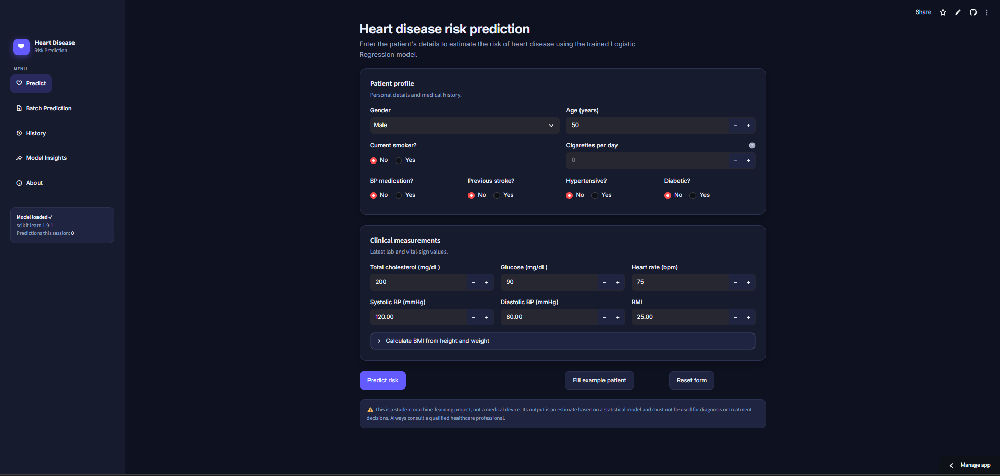
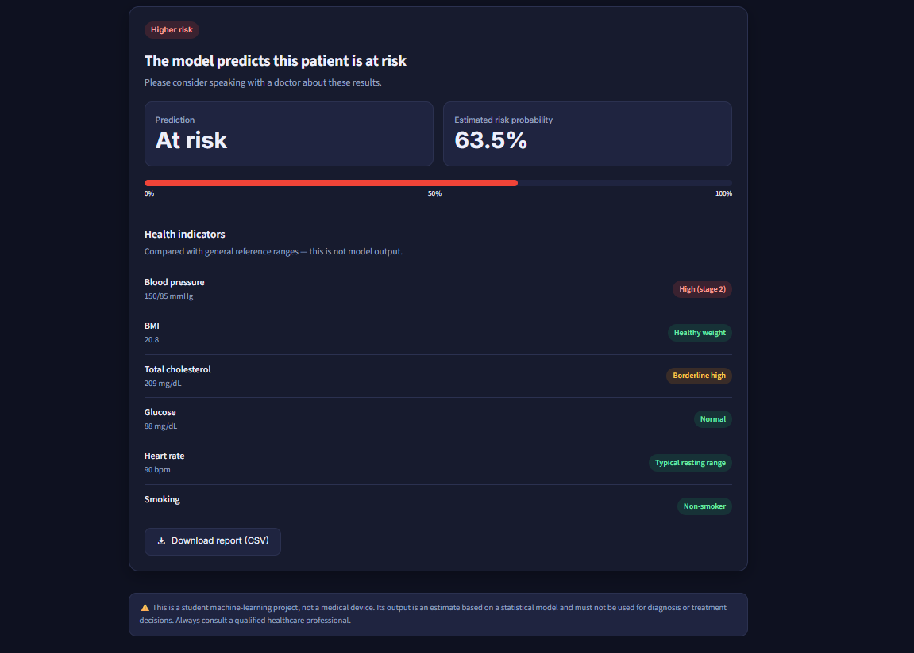
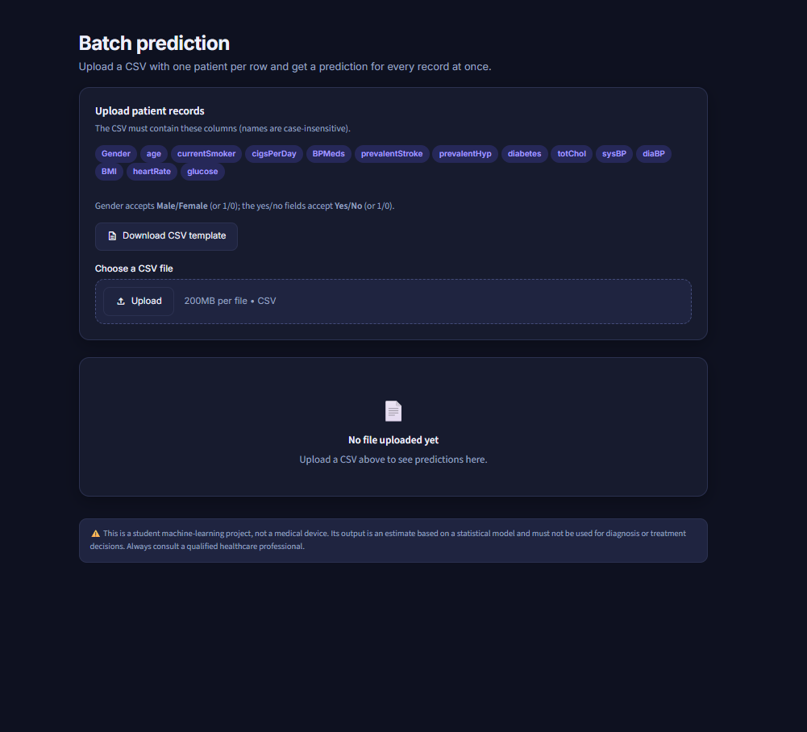
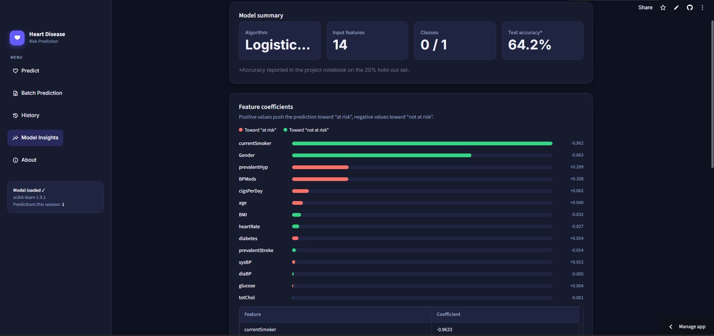

# ❤️ Heart Disease Risk Prediction

A machine learning-based **Heart Disease Risk Prediction** web application built with **Python, Scikit-learn, Pandas, and Streamlit**.

The application uses a trained **Logistic Regression** model to estimate whether a patient may be **at risk** or **not at risk** based on demographic information, medical history, clinical measurements, and lifestyle-related features.

> ⚠️ **Disclaimer:** This is a student machine-learning project, not a medical device. Its output is a statistical estimate and must not be used for diagnosis or treatment decisions. Always consult a qualified healthcare professional.

---

## 📸 Application Screenshots

### 🏠 Prediction Dashboard

<!-- Replace with your actual screenshot -->


The main prediction page allows users to enter patient information and generate a heart-disease risk prediction.

---

### 📊 Prediction Result

<!-- Replace with your actual screenshot -->


The result page displays:

- Prediction status
- Estimated risk probability
- Health indicator summary
- Blood pressure category
- BMI category
- Cholesterol category
- Glucose category
- Heart-rate category
- Smoking status
- Downloadable prediction report

---

### 📁 Batch Prediction

<!-- Replace with your actual screenshot -->


Users can upload a CSV file containing multiple patient records and receive predictions for all valid records at once.

---

### 📈 Model Insights

<!-- Replace with your actual screenshot -->


The Model Insights page provides information about:

- Model algorithm
- Number of input features
- Model classes
- Test accuracy
- Feature coefficients
- Training process
- Dataset preparation
- SMOTE balancing

---

## 🚀 Live Demo

**Streamlit App:**  
[Add your Streamlit deployment URL here]

---

## ✨ Features

### 👤 Individual Prediction

Enter information for a single patient, including:

- Gender
- Age
- Current smoking status
- Cigarettes per day
- Blood-pressure medication
- Previous stroke
- Hypertension
- Diabetes
- Total cholesterol
- Systolic blood pressure
- Diastolic blood pressure
- BMI
- Heart rate
- Glucose

The application then generates a model prediction.

---

### 📂 Batch Prediction

The application supports CSV-based batch prediction.

Users can:

1. Download the CSV template.
2. Fill in patient records.
3. Upload the CSV.
4. Validate the input data.
5. Generate predictions for all valid rows.
6. Download the prediction results.

The application also detects:

- Missing columns
- Blank values
- Unreadable values
- Invalid rows

Invalid rows are skipped instead of stopping the entire prediction process.

---

### 🕘 Prediction History

The application keeps prediction history during the current Streamlit session.

Users can:

- View previous predictions
- See prediction timestamps
- Review patient information
- See risk probabilities
- Download prediction history
- Clear the history

> History is session-based and is cleared when the Streamlit session ends.

---

### 📊 Model Insights

The application includes a dedicated Model Insights page.

It displays:

- Model algorithm
- Number of features
- Model classes
- Test accuracy
- Logistic Regression coefficients
- Feature directions
- Training summary

Positive coefficients indicate movement toward the **"At risk"** class, while negative coefficients indicate movement toward the **"Not at risk"** class.

---

### 🧮 BMI Calculator

Users can calculate BMI directly inside the application by entering:

- Height in centimeters
- Weight in kilograms

The calculated BMI can then be automatically applied to the prediction form.

---

### 📥 Downloadable Reports

Prediction results can be exported as CSV files.

Available downloads include:

- Individual prediction report
- Batch prediction results
- Prediction history
- CSV input template

---

## 🧠 Machine Learning Model

The application uses:

### Logistic Regression

Logistic Regression is a supervised classification algorithm used to estimate the probability of an observation belonging to a particular class.

In this project:

```text
0 → Not at risk
1 → At risk
```

The trained model is stored in:

```text
model.pkl
```

The Streamlit application loads this model using Python's `pickle` module.

---

## 📊 Model Performance

According to the project notebook, the model achieved:

| Metric | Result |
|---|---:|
| Test Accuracy | **64.2%** |
| Test Split | **20%** |
| Training Split | **80%** |

The reported accuracy comes from the project's **20% hold-out test set**.

> The application displays this value as a project-notebook result rather than recalculating model performance during inference.

---

## 📚 Dataset

The project uses a heart-disease dataset containing:

```text
4,238 patient records
15 columns
```

The dataset contains:

- 14 input features
- 1 heart-disease outcome column

### Dataset Processing

The project notebook performs the following preparation steps:

1. Removes the `education` column.
2. Handles missing values by removing incomplete rows.
3. Converts relevant categorical fields into numerical values.
4. Separates input features and target.
5. Balances the target classes using SMOTE.
6. Splits the data into training and testing sets.
7. Trains the Logistic Regression model.
8. Saves the trained model as `model.pkl`.

After removing the `education` column and rows containing missing values:

```text
3,749 records
```

remain.

---

## ⚖️ Class Balancing with SMOTE

The original cleaned dataset contained an imbalanced target:

```text
No  → 3,177
Yes →   572
```

To address the class imbalance, **SMOTE (Synthetic Minority Over-sampling Technique)** was applied.

After balancing:

```text
No  → 3,177
Yes → 3,177
```

Total balanced records:

```text
6,354
```

---

## 🔢 Input Features

The trained model expects the following 14 features in this exact order:

```text
Gender
age
currentSmoker
cigsPerDay
BPMeds
prevalentStroke
prevalentHyp
diabetes
totChol
sysBP
diaBP
BMI
heartRate
glucose
```

### Feature Description

| Feature | Description |
|---|---|
| `Gender` | Patient gender |
| `age` | Age in years |
| `currentSmoker` | Current smoking status |
| `cigsPerDay` | Cigarettes smoked per day |
| `BPMeds` | Blood-pressure medication status |
| `prevalentStroke` | Previous stroke status |
| `prevalentHyp` | Hypertension status |
| `diabetes` | Diabetes status |
| `totChol` | Total cholesterol in mg/dL |
| `sysBP` | Systolic blood pressure |
| `diaBP` | Diastolic blood pressure |
| `BMI` | Body Mass Index |
| `heartRate` | Resting heart rate |
| `glucose` | Blood glucose level |

---

## 🔄 Prediction Workflow

```text
Patient Input
      │
      ▼
Input Validation
      │
      ▼
Feature Encoding
      │
      ▼
Create DataFrame
      │
      ▼
Trained Logistic Regression
      │
      ▼
Prediction
      │
      ├───────────────┐
      ▼               ▼
Not at risk        At risk
      │               │
      └───────┬───────┘
              ▼
      Risk Probability
              │
              ▼
       Health Indicators
              │
              ▼
       Download Report
```

---

## 🏥 Health Indicators

The application also provides general reference-based indicators for:

### Blood Pressure

The application categorizes blood pressure into:

- Normal
- Elevated
- High (stage 1)
- High (stage 2)
- Hypertensive crisis range

### BMI

The application categorizes BMI as:

- Underweight
- Healthy weight
- Overweight
- Obese

### Total Cholesterol

Categories include:

- Desirable
- Borderline high
- High

### Glucose

Categories include:

- Normal
- Elevated
- High

### Heart Rate

Categories include:

- Below typical resting range
- Typical resting range
- Above typical resting range

> These indicators are reference information shown by the application and are **not model predictions**.

---

## 🛠️ Technology Stack

| Technology | Purpose |
|---|---|
| Python | Programming language |
| Streamlit | Web application framework |
| Pandas | Data processing |
| Scikit-learn | Machine learning |
| Logistic Regression | Classification model |
| SMOTE | Class balancing |
| Pickle | Model serialization |
| HTML/CSS | Custom UI styling |

---

## 🎨 User Interface

The application uses a custom dark-themed UI with:

- Purple/lavender accent colors
- Responsive layout
- Fixed sidebar navigation
- Custom cards
- Custom buttons
- Custom input fields
- Prediction status pills
- Progress bars
- Responsive mobile styling
- Dark-friendly data tables

### Navigation

```text
❤️ Heart Disease
│
├── Predict
├── Batch Prediction
├── History
├── Model Insights
└── About
```

---

## 📁 Project Structure

```text
Heart-Disease-Prediction/
│
├── app.py
├── model.pkl
├── requirements.txt
├── README.md
│
└── images/
    ├── prediction-dashboard.png
    ├── prediction-result.png
    ├── batch-prediction.png
    └── model-insights.png
```

> Your project only requires `app.py` and the trained `model.pkl` for the application itself. The `images/` directory is only for README screenshots.

---

## ⚙️ Installation

### 1. Clone the repository

```bash
git clone https://github.com/tanvir-50198/Heart-Disease-Prediction-Machine-Learning-Model.git
```

### 2. Navigate to the project directory

```bash
cd Heart-Disease-Prediction-Machine-Learning-Model
```

### 3. Create a virtual environment

Windows:

```bash
python -m venv .venv
```

Activate it:

```bash
.venv\Scripts\activate
```

---

### 4. Install dependencies

```bash
pip install -r requirements.txt
```

---

### 5. Make sure `model.pkl` exists

The application expects:

```text
model.pkl
```

in the same directory as:

```text
app.py
```

---

### 6. Run the application

```bash
streamlit run app.py
```

The application will open in your browser.

---

## 📦 Requirements

Example `requirements.txt`:

```text
streamlit
pandas
scikit-learn
```

If your saved model was trained using additional libraries, those libraries should also be included in `requirements.txt`.

---

## 📄 CSV Batch Prediction Format

The uploaded CSV must contain these columns:

```text
Gender
age
currentSmoker
cigsPerDay
BPMeds
prevalentStroke
prevalentHyp
diabetes
totChol
sysBP
diaBP
BMI
heartRate
glucose
```

### Example

```csv
Gender,age,currentSmoker,cigsPerDay,BPMeds,prevalentStroke,prevalentHyp,diabetes,totChol,sysBP,diaBP,BMI,heartRate,glucose
Female,59,No,0,No,No,Yes,No,209,150,85,20.77,90,88
```

The application accepts:

```text
Gender:
Male / Female
1 / 0

Binary fields:
Yes / No
1 / 0
```

Column names are handled case-insensitively.

---

## 🧪 Example Prediction

The application includes an example patient:

```text
Gender: Female
Age: 59
Current smoker: No
Cigarettes/day: 0
BP medication: No
Previous stroke: No
Hypertensive: Yes
Diabetic: No
Total cholesterol: 209 mg/dL
Systolic BP: 150 mmHg
Diastolic BP: 85 mmHg
BMI: 20.77
Heart rate: 90 bpm
Glucose: 88 mg/dL
```

You can load this example directly using:

```text
Fill example patient
```

---

## 🔐 Model Loading

The application automatically searches for the model using:

```python
MODEL_PATH = Path(__file__).parent / "model.pkl"
```

This means `model.pkl` does not need to be referenced using an absolute path.

The model is loaded with Streamlit's resource cache:

```python
@st.cache_resource
def load_model():
    ...
```

This avoids repeatedly loading the model during normal Streamlit reruns.

---

## 🧩 Error Handling

The application includes validation and error handling for:

- Missing `model.pkl`
- Model loading errors
- Incompatible scikit-learn versions
- Missing CSV columns
- Empty CSV files
- Invalid CSV values
- Invalid patient rows
- Model prediction failures
- Invalid blood-pressure relationships

For example, if systolic blood pressure is lower than or equal to diastolic blood pressure, the application displays a warning.

---

## ⚠️ Important Limitation

This project is intended for **educational and portfolio purposes**.

It should not be used as:

- A medical diagnostic system
- A replacement for a doctor
- A treatment recommendation system
- A clinical decision-making tool

The model's prediction represents a statistical estimate based on the training data and selected features.

---

## 👨‍💻 Author

**Abdur Rahman Tanvir**

B.Sc. in Computer Science and Engineering  
American International University-Bangladesh (AIUB)

### Areas of Interest

- Machine Learning
- Artificial Intelligence
- Data Science
- Backend Development
- Full-Stack Development

### Profiles

- GitHub: https://github.com/tanvir-50198
- LinkedIn: https://linkedin.com/in/tanvir-rahman-50198/

---

## ⭐ Future Improvements

Possible future improvements include:

- Better model performance
- Additional classification algorithms
- Cross-validation
- Hyperparameter tuning
- ROC-AUC analysis
- Precision, recall and F1-score reporting
- Confusion matrix visualization
- Explainable AI methods such as SHAP
- Persistent prediction history
- User authentication
- Database integration
- Improved model calibration

---

## 📜 License

This project is intended for educational and portfolio purposes.

---

## ⭐ Support

If you find this project useful, consider giving the repository a ⭐ on GitHub.