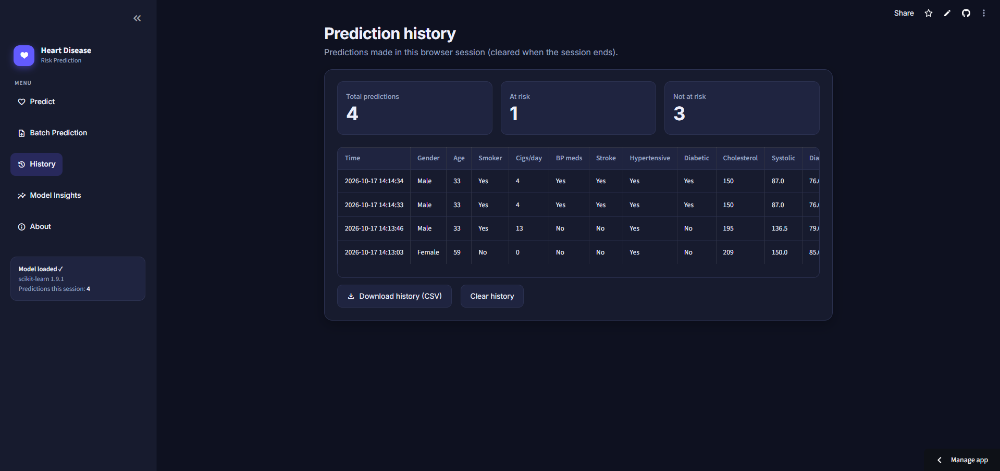

# ❤️ Heart Disease Risk Prediction

A machine learning-based **Heart Disease Risk Prediction** web application built with **Python, Scikit-learn, Pandas, and Streamlit**.

The application uses a trained **Logistic Regression** model to estimate whether a patient may be **at risk** or **not at risk** based on demographic information, medical history, clinical measurements, and lifestyle-related features.

> ⚠️ **Disclaimer:** This is a student machine-learning project, not a medical device. Its output is a statistical estimate and must not be used for diagnosis or treatment decisions. Always consult a qualified healthcare professional.

---

## 🚀 Live Demo

Try the deployed application:

**🌐 Streamlit App:**  
https://heart-disease-prediction-machine-learning-model-vrbmhep6zsbvjk.streamlit.app/

## 💻 GitHub Repository

View the complete source code and project files:

**🔗 GitHub:**  
https://github.com/tanvir-50198/Heart-Disease-Prediction-Machine-Learning-Model

---

## 📸 Application Screenshots

> Add your screenshots to the `images/` folder using the filenames shown below.

### 🏠 Prediction Dashboard


The main prediction page allows users to enter patient information and generate a heart-disease risk prediction.

---

### 📊 Prediction Result


The result section displays:

- Prediction status
- Estimated risk probability
- Health indicators
- Blood pressure category
- BMI category
- Cholesterol category
- Glucose category
- Heart-rate category
- Smoking status
- Downloadable prediction report

---

### 📁 Batch Prediction


Users can upload a CSV containing multiple patient records and generate predictions for all valid records.

---

### 🕘 Prediction History



The History page keeps track of predictions made during the current Streamlit session.

---

### 📈 Model Insights


The Model Insights page provides information about:

- Machine learning algorithm
- Input features
- Model classes
- Test accuracy
- Feature coefficients
- Training process
- Dataset preparation
- SMOTE class balancing

---

# ✨ Features

## 👤 Individual Prediction

Users can enter information for an individual patient.

The application accepts:

- Gender
- Age
- Current smoking status
- Cigarettes per day
- Blood-pressure medication
- Previous stroke
- Hypertension
- Diabetes
- Total cholesterol
- Systolic blood pressure
- Diastolic blood pressure
- BMI
- Heart rate
- Glucose

After entering the information, the trained model generates a prediction.

---

## 📂 Batch Prediction

The application supports prediction for multiple patients through a CSV file.

### Workflow

1. Download the CSV template.
2. Add patient records.
3. Upload the CSV.
4. The application validates the data.
5. Invalid rows are skipped.
6. Predictions are generated for valid records.
7. Results can be downloaded as a CSV file.

The batch system also detects:

- Missing columns
- Empty files
- Blank values
- Unreadable values
- Invalid rows
- Prediction errors

---

## 🕘 Prediction History

The application maintains prediction history during the current Streamlit session.

Users can:

- View previous predictions
- View prediction timestamps
- Review patient information
- View prediction results
- View estimated risk probabilities
- Download history as CSV
- Clear prediction history

> Prediction history is session-based and is cleared when the Streamlit session ends.

---

## 📊 Model Insights

The application contains a dedicated **Model Insights** page.

It displays:

- Algorithm name
- Number of input features
- Model classes
- Test accuracy
- Feature coefficients
- Coefficient direction
- Training summary

For Logistic Regression:

- Positive coefficients indicate movement toward the **At Risk** class.
- Negative coefficients indicate movement toward the **Not at Risk** class.

---

## 🧮 BMI Calculator

Users can calculate BMI directly inside the application.

They can enter:

- Height in centimeters
- Weight in kilograms

The application calculates BMI automatically and allows the calculated value to be applied to the prediction form.

---

## 📥 Downloadable Reports

The application provides downloadable CSV files for:

### Individual Prediction

```text
heart_disease_prediction.csv
```

### Batch Prediction

```text
heart_disease_batch_results.csv
```

### Prediction History

```text
heart_disease_history.csv
```

### CSV Template

```text
heart_disease_template.csv
```

---

# 🧠 Machine Learning

## Logistic Regression

The application uses **Logistic Regression** as its classification algorithm.

The model predicts two classes:

```text
0 → Not at risk
1 → At risk
```

The trained model is stored in:

```text
model.pkl
```

The Streamlit application loads the trained model using Python's `pickle` module.

---

# 📊 Model Performance

According to the project notebook, the model achieved:

| Metric | Result |
|---|---:|
| Test Accuracy | **64.2%** |
| Training Split | **80%** |
| Testing Split | **20%** |

The reported accuracy comes from the project's **20% hold-out test set**.

> The application displays this project-notebook accuracy in the Model Insights page.

---

# 📚 Dataset

The project uses a heart-disease dataset containing:

```text
4,238 patient records
15 columns
```

The dataset consists of:

```text
14 input features
+
1 heart-disease outcome
```

---

## 🧹 Data Preprocessing

The project notebook performs several preprocessing steps.

### 1. Remove unnecessary column

The `education` column is removed.

### 2. Handle missing values

Rows containing missing values are removed.

After cleaning:

```text
3,749 records
```

remain.

### 3. Encode categorical values

Relevant categorical variables are converted into numerical representations.

For example:

```text
Male   → 1
Female → 0
```

and binary variables are represented as:

```text
Yes → 1
No  → 0
```

### 4. Separate features and target

The dataset is divided into:

```text
X → Input features
y → Target variable
```

### 5. Handle class imbalance

SMOTE is used to balance the target classes.

### 6. Train/test split

The data is divided into:

```text
80% → Training
20% → Testing
```

### 7. Train Logistic Regression

The Logistic Regression model is trained using the processed training data.

### 8. Save the model

The trained model is serialized into:

```text
model.pkl
```

---

# ⚖️ SMOTE Class Balancing

The cleaned dataset contained an imbalanced target distribution:

| Class | Records |
|---|---:|
| No | 3,177 |
| Yes | 572 |

The project uses **SMOTE (Synthetic Minority Over-sampling Technique)** to address this imbalance.

After applying SMOTE:

| Class | Records |
|---|---:|
| No | 3,177 |
| Yes | 3,177 |

Total balanced records:

```text
6,354
```

---

# 🔢 Model Input Features

The model expects the following **14 features in this exact order**:

```text
Gender
age
currentSmoker
cigsPerDay
BPMeds
prevalentStroke
prevalentHyp
diabetes
totChol
sysBP
diaBP
BMI
heartRate
glucose
```

---

## Feature Description

| Feature | Description |
|---|---|
| `Gender` | Patient gender |
| `age` | Age in years |
| `currentSmoker` | Current smoking status |
| `cigsPerDay` | Number of cigarettes smoked per day |
| `BPMeds` | Blood-pressure medication status |
| `prevalentStroke` | Previous stroke status |
| `prevalentHyp` | Hypertension status |
| `diabetes` | Diabetes status |
| `totChol` | Total cholesterol in mg/dL |
| `sysBP` | Systolic blood pressure |
| `diaBP` | Diastolic blood pressure |
| `BMI` | Body Mass Index |
| `heartRate` | Resting heart rate |
| `glucose` | Blood glucose level in mg/dL |

---

# 🔄 Prediction Workflow

```text
              Patient Information
                       │
                       ▼
                Input Validation
                       │
                       ▼
                 Feature Encoding
                       │
                       ▼
                 Pandas DataFrame
                       │
                       ▼
             Trained Logistic Regression
                       │
                       ▼
                  Prediction
                 /          \
                /            \
               ▼              ▼
          Not at risk       At risk
               \              /
                \            /
                 ▼          ▼
                Risk Probability
                       │
                       ▼
                Health Indicators
                       │
                       ▼
                 Download Report
```

---

# 🏥 Health Indicators

In addition to the machine-learning prediction, the application provides general reference-based health indicators.

These are **not model predictions**.

## Blood Pressure

The application categorizes blood pressure as:

- Normal
- Elevated
- High (stage 1)
- High (stage 2)
- Hypertensive crisis range

## BMI

Categories:

- Underweight
- Healthy weight
- Overweight
- Obese

## Total Cholesterol

Categories:

- Desirable
- Borderline high
- High

## Glucose

Categories:

- Normal
- Elevated
- High

## Heart Rate

Categories:

- Below typical resting range
- Typical resting range
- Above typical resting range

---

# 📁 CSV Batch Prediction Format

The uploaded CSV must contain the following columns:

```text
Gender
age
currentSmoker
cigsPerDay
BPMeds
prevalentStroke
prevalentHyp
diabetes
totChol
sysBP
diaBP
BMI
heartRate
glucose
```

Column names are handled case-insensitively.

---

## Example CSV

```csv
Gender,age,currentSmoker,cigsPerDay,BPMeds,prevalentStroke,prevalentHyp,diabetes,totChol,sysBP,diaBP,BMI,heartRate,glucose
Female,59,No,0,No,No,Yes,No,209,150,85,20.77,90,88
```

### Accepted values

Gender:

```text
Male
Female
1
0
```

Binary fields:

```text
Yes
No
1
0
```

---

# 🧪 Example Patient

The application includes a built-in example patient.

```text
Gender: Female
Age: 59
Current smoker: No
Cigarettes/day: 0
BP medication: No
Previous stroke: No
Hypertensive: Yes
Diabetic: No
Total cholesterol: 209 mg/dL
Systolic BP: 150 mmHg
Diastolic BP: 85 mmHg
BMI: 20.77
Heart rate: 90 bpm
Glucose: 88 mg/dL
```

Users can load this example using:

```text
Fill example patient
```

---

# 🛠️ Technology Stack

| Technology | Purpose |
|---|---|
| **Python** | Programming language |
| **Streamlit** | Web application |
| **Pandas** | Data processing |
| **Scikit-learn** | Machine learning |
| **Logistic Regression** | Classification |
| **SMOTE** | Class balancing |
| **Pickle** | Model serialization |
| **HTML/CSS** | Custom interface |

---

# 🎨 User Interface

The application includes a custom dark-themed interface.

### UI Features

- Dark mode
- Purple/lavender accent design
- Fixed sidebar navigation
- Responsive layout
- Custom cards
- Custom buttons
- Custom input fields
- Prediction status badges
- Risk probability progress bar
- Health indicator cards
- Custom data tables
- Responsive mobile styling

---

## Navigation

```text
❤️ Heart Disease Risk Prediction
│
├── ❤️ Predict
│
├── 📁 Batch Prediction
│
├── 🕘 History
│
├── 📈 Model Insights
│
└── ℹ️ About
```

---

# 📂 Project Structure

```text
Heart-Disease-Prediction-Machine-Learning-Model/
│
├── app.py
├── model.pkl
├── requirements.txt
├── README.md
│
└── images/
    ├── prediction-dashboard.png
    ├── prediction-result.png
    ├── batch-prediction.png
    ├── prediction-history.png
    └── model-insights.png
```

### Main Files

| File | Description |
|---|---|
| `app.py` | Main Streamlit application |
| `model.pkl` | Trained Logistic Regression model |
| `requirements.txt` | Python dependencies |
| `README.md` | Project documentation |
| `images/` | README screenshots |

---

# ⚙️ Installation & Setup

## 1. Clone the Repository

```bash
git clone https://github.com/tanvir-50198/Heart-Disease-Prediction-Machine-Learning-Model.git
```

---

## 2. Open the Project

```bash
cd Heart-Disease-Prediction-Machine-Learning-Model
```

---

## 3. Create a Virtual Environment

For Windows:

```bash
python -m venv .venv
```

Activate it:

```bash
.venv\Scripts\activate
```

---

## 4. Install Dependencies

```bash
pip install -r requirements.txt
```

---

## 5. Check `model.pkl`

Make sure the trained model is located in the same directory as `app.py`:

```text
app.py
model.pkl
```

The application automatically searches for:

```python
Path(__file__).parent / "model.pkl"
```

---

## 6. Run the Application

```bash
streamlit run app.py
```

The application will then open in your browser.

---

# 📦 Requirements

A basic `requirements.txt` can contain:

```text
streamlit
pandas
scikit-learn
```

The exact dependencies should match the environment used to train and save `model.pkl`.

> The application also checks the installed Scikit-learn version when loading the saved model because model compatibility can depend on the version used during training.

---

# 🔐 Model Loading

The trained model is loaded from:

```text
model.pkl
```

using Python's `pickle` module.

The application uses Streamlit resource caching:

```python
@st.cache_resource
def load_model():
    with open(MODEL_PATH, "rb") as f:
        return pickle.load(f)
```

This prevents unnecessary repeated model loading during Streamlit reruns.

---

# 🧩 Validation & Error Handling

The application includes error handling for:

- Missing `model.pkl`
- Model loading errors
- Scikit-learn version incompatibility
- Missing CSV columns
- Empty CSV files
- Invalid CSV values
- Blank patient fields
- Invalid batch rows
- Prediction failures
- Incorrect blood-pressure relationships

For example, the application warns users if:

```text
Systolic BP <= Diastolic BP
```

---

# 📌 Important Limitations

This project is designed for **educational and portfolio purposes**.

It should **not** be used as:

- A medical diagnostic system
- A clinical decision-making system
- A replacement for a healthcare professional
- A treatment recommendation system

The model's prediction is a statistical estimate based on the dataset and trained machine-learning model.

---

# 🔮 Future Improvements

Possible future improvements include:

- Cross-validation
- Hyperparameter tuning
- Precision, Recall and F1-score analysis
- Confusion matrix visualization
- ROC-AUC analysis
- Model comparison
- Random Forest implementation
- XGBoost implementation
- Model calibration
- SHAP-based explainable AI
- Persistent prediction history
- Database integration
- User authentication
- Improved risk calibration
- Automated model retraining

---

# 👨‍💻 Author

## Abdur Rahman Tanvir

**B.Sc. in Computer Science and Engineering**  
American International University-Bangladesh (AIUB)

### Interests

- Machine Learning
- Artificial Intelligence
- Data Science
- Backend Development
- Full-Stack Development

### 🔗 Profiles

- **GitHub:** https://github.com/tanvir-50198
- **LinkedIn:** https://linkedin.com/in/tanvir-rahman-50198/

---

# 🔗 Project Links

| Resource | Link |
|---|---|
| 🌐 **Live Demo** | https://heart-disease-prediction-machine-learning-model-vrbmhep6zsbvjk.streamlit.app/ |
| 💻 **GitHub Repository** | https://github.com/tanvir-50198/Heart-Disease-Prediction-Machine-Learning-Model |

---

# ⭐ Support

If you find this project useful, consider giving the repository a ⭐ on GitHub.

**Thank you for visiting the project! ❤️**